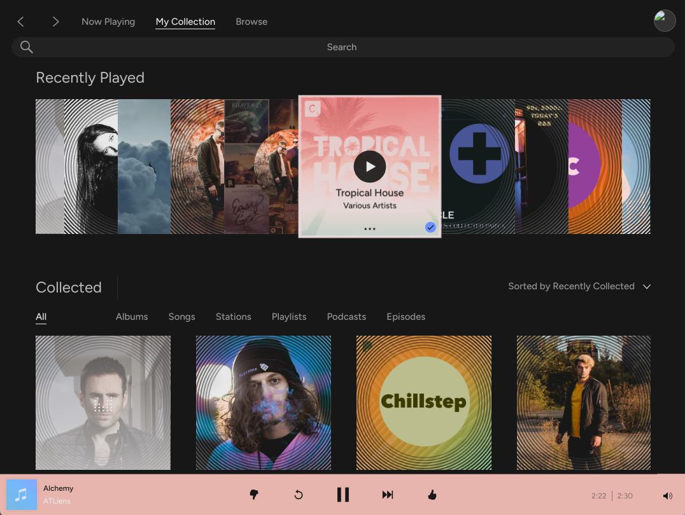

# Pandora Dark Mode for Windows

A custom version of the Windows Pandora desktop app with a dark-mode appearance.

## Download

**[Download Pandora Dark Mode (ZIP)](https://github.com/tylerwyler9-ui/PandoraDarkMode/archive/refs/heads/main.zip)**

You can also select the green **Code** button above, then **Download ZIP**. No GitHub account or Git software is needed to download this public repository.

## Get started

1. Download the ZIP using the link above.
2. Right-click the downloaded ZIP and choose **Extract All**.
3. Open the extracted `PandoraDarkMode-main` folder.
4. Open `WinPandoraDarkMode v1.2`, then the second `WinPandoraDarkMode v1.2` folder, then `app`.
5. Open **Pandora.exe**.

Keep the entire `app` folder together. The executable needs the accompanying files and folders; downloading or moving only `Pandora.exe` is not enough.

## Where are the files?

[Browse the application folder](https://github.com/tylerwyler9-ui/PandoraDarkMode/tree/main/WinPandoraDarkMode%20v1.2/WinPandoraDarkMode%20v1.2/app)

This repository currently contains the packaged Windows application, including its supporting runtime files. The folder is labeled version **1.2**.

## Feedback

[Report a problem or suggest an improvement](https://github.com/tylerwyler9-ui/PandoraDarkMode/issues). Include your Windows version, what you expected, and what happened.

## About

This is an unofficial customization and is not affiliated with or endorsed by Pandora. Pandora and third-party components remain the property of their respective owners. Included third-party license notices are retained with the application.
